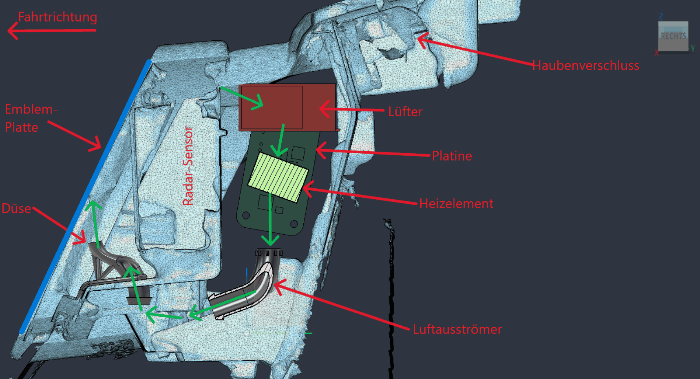
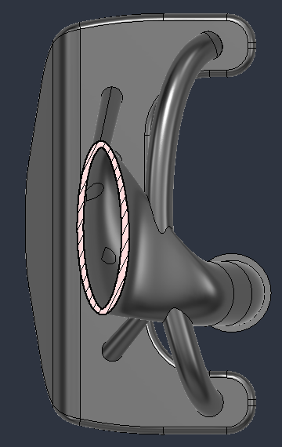
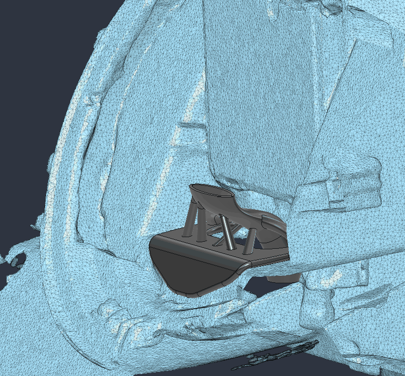
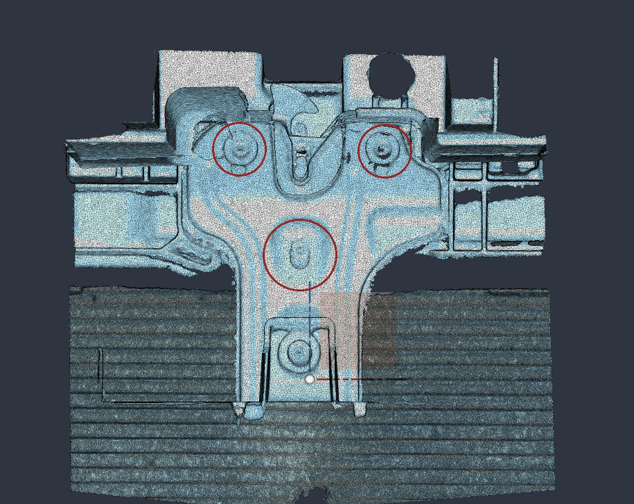

# Luftführung und Düse

Wie die Luft vom Lüfter zum Emblem gelangt, welche Teile beteiligt sind und was
noch offen ist. Grundlage ist die Fusion-Konstruktion des Projektinhabers (Stand
v17, liegt lokal, nicht im Git) über dem 3D-Scan der Front des Referenzfahrzeugs
(Golf 7 Facelift, siehe [`scan-daten.md`](../vehicles/golf7-facelift/scan-daten.md)).

> **Stand: Konstruktion, nicht im Fahrzeug erprobt.** Die Wirkung am Emblem ist
> nicht gemessen, die Düse ist in dieser Form **nicht 3D-druckbar** und die
> Befestigung im Fahrzeug ist **offen**. Siehe Abschnitt "Offene Punkte".

## Luftweg

*Seitenansicht (von rechts), Fahrtrichtung nach links. Blau: Emblemplatte.
Grün: Luftweg.*

1. Der **Lüfter** (Radiallüfter) saugt Luft aus dem umgebenden Bauraum an.
2. Er bläst sie nach unten **durch das Heizelement**, das auf der Platine sitzt.
3. Ein gebogener **Luftausströmer** führt die erwärmte Luft nach vorn, **unter dem
   Radarsensor** hindurch.
4. Die **Düse** lenkt sie von unten **an der Rückseite der Emblemplatte entlang
   nach oben**.

**Angeblasen wird nur die Emblemplatte, nicht der Radarsensor selbst.**

### Ansaugung und Abluft

- Der Bauraum ist rund um den Lüfter relativ offen. Beim Fahren drückt der
  Fahrtwind kalte Luft durch den Grill in diesen Bauraum.
- Die eingeblasene Luft wird **nicht gezielt weitergeführt**. Sie entweicht
  durch die Schlitze und Öffnungen des Bauraums.
- Ob diese offene Auslegung für die Wärme am Emblem günstig ist, ist **nicht
  untersucht** (weder per Simulation noch am Fahrzeug).

## Düse

Die Düse läuft von einem runden Anschluss trichterförmig in eine **schmale,
ovale Mündung** aus. Im Schnitt ist die Wandkontur der Mündung zu sehen:

- **Bügel:** Die Düse hat eine Grundplatte mit Bügeln, die auf den **Radarhalter
  aufgeklebt** wird. So bleibt sie ohne Schrauben in Position.
- **Streben:** Dünne Streben halten die Mündung in Position gegenüber der
  Grundplatte.
- **Nicht druckbar:** Die Streben sind so, wie sie konstruiert sind, im 3D-Druck
  nicht herstellbar. Eine druckgerechte Neukonstruktion ist offen
  ([Issue #32](https://github.com/sandboop/ACC-Radar-Heizung/issues/32)).
- Maße der Mündung und Wandstärke sind hier noch nicht dokumentiert. Sie lassen
  sich aus dem Scan und dem CAD-Stand ergänzen.

## Befestigung des Gehäuses im Fahrzeug

**Offen.** Das Gehäuse mit Lüfter, Heizelement und Platine ist noch nicht im
Fahrzeug befestigt. Ein möglicher Anknüpfungspunkt ist der **Haubenverschluss**
(Frontansicht des Scans, geschnitten):

Die rot markierten Stellen sind Schraubpunkte der Verschlussplatte. Unten im
Halter gibt es eine weitere Schraube, die nicht markiert ist: Es ist unklar, ob
man sie lösen darf oder ob sich dabei die Position des Radars verändert und der
Radar neu vermessen werden müsste. Dort ließe sich etwas anschrauben. Alternativ wäre ein **Halter** denkbar, der **geklemmt** oder an
einer anderen Stelle verschraubt wird. Vorschläge sind ausdrücklich willkommen.

## Bisherige Erfahrung

Aus einem **früheren Testlauf** (Aussage des Projektinhabers, schon länger her,
**kein dokumentiertes Messprotokoll**):

| Größe | Wert |
|---|---|
| Lüfter | Radiallüfter |
| Heizelement | PTC, 40 W |
| Ansaugluft | etwa −3 °C |
| ausströmende Luft | etwa 40 °C am **Auslass des Luftausströmers** (nicht an der Düsenmündung, die ist nicht gemessen), bei relativ geringer Strömung durch das Heizelement |
| Heizelement | erreichte etwa 100 °C |
| Halterung | PETG, nicht geschmolzen |

Das ist ein Einzelversuch ohne Fahrtwind und ohne Schnee. Er sagt nichts darüber
aus, ob das Emblem im Betrieb warm genug wird. Messort, Abstand zur Düse und
Strömungsmenge sind nicht festgehalten. Weitere Erfahrungswerte gibt es nicht.

**Abgrenzung zur Firmware:** Der Testlauf entstand mit einem früheren Stand, nicht
mit den Abschaltgrenzen der aktuellen Firmware. Dort löst die Übertemperatur am
Heizelement (Fehler 4) laut [`verhalten.md`](verhalten.md) bei 30 °C aus, markiert
als "Auslegung offen". Gegen die etwa 100 °C des Testlaufs ist dieser Wert
offensichtlich nicht abgestimmt. Wo der NTC sitzt und welche Grenze sinnvoll ist,
muss zusammen mit der Mechanik festgelegt werden (dazu gehört auch die
Thermosicherung aus `verhalten.md`, Abschnitt 7).

## Regelgröße: Energie statt Oberflächentemperatur?

Die Firmware regelt bisher auf die Temperatur der Emblemplatte (Zweipunktregelung,
siehe [`verhalten.md`](verhalten.md), Abschnitt 5). Das ist ein Stellvertreter für
das eigentliche Ziel: genug Wärme zuzuführen, damit Schnee flüssig bleibt. Eine
bestimmte Oberflächentemperatur ist dafür kein Selbstzweck. Eher niedrige
Temperaturen sind günstig, weil die Verluste an den Fahrtwind sinken und das
Emblem weniger belastet wird.

**Alle Grenz- und Sollwerte im Code sind Versuchswerte.** Sie sollen mit Versuchen
angepasst und belegt werden. Denkbar ist ein **empirisch gemessener
Temperaturkoeffizient** der Emblemplatte (benötigte Leistung je Kelvin bei
gegebener Außentemperatur und gegebenem Luftstrom), der die Kennlinie der
Solltemperatur ersetzt oder untermauert. Gemessen ist dazu noch nichts.

**Idee, nicht entschieden:** Ein NTC lässt sich beim Selbstbau ein Stück neben der
Idealposition aufkleben. Das System soll so fehlerarm wie möglich aufzubauen
sein. Deshalb wird eine **kontaktlose Messung mit einem Thermopile** erwogen,
in einer Fassung an der Düse:

- **Position:** entweder direkt unter der Düse, zielgerichtet auf die
  voraussichtlich wärmste angeblasene Stelle, oder seitlich neben der Düse.
- **Bauform:** Der MLX90614 (Thermopile auf eigener Platine, I2C) ist nur ein
  Beispiel. Denkbar ist auch ein einzelnes Thermopile an der Düse mit der
  Auswerteelektronik auf der Hauptplatine.
- **Einordnung:** Ein mögliches Feature, das Aufbau und Betrieb vereinfachen
  könnte, **keiner Platinenversion zugeordnet**. Ob sich der Aufwand lohnt, ist
  offen. Zu prüfen sind Strahlengang, Einbau und die Schnittstelle (V3.2 hat nur
  Software-I2C auf PB0/PB1, siehe [`DECISIONS.md`](../DECISIONS.md)).
- **Radar:** Der Sensor samt Metallgehäuse darf nicht vor der Radarantenne liegen.

## Warum Luft und keine Flächenheizung am Emblem?

Metall und Wasser blockieren oder dämpfen Radarstrahlen. Heizdrähte und
Heizfolien vor der Antenne gelten daher als riskant (siehe
[`hintergrund-forum.md`](hintergrund-forum.md) und [FAQ](faq.md)). Deshalb arbeitet
das Projekt mit Luft.

Das schließt eine Flächenheizung **nicht aus**. Wie stark sie die Empfangsleistung
tatsächlich beeinträchtigen würde, ist nicht gemessen. Die Steuerung ließe sich
auf eine Flächenheizung anpassen, wenn der Radar das hergibt. Ob das Material
von Düse und Emblem selbst unkritisch ist, ist ebenfalls **ungeprüft**.

## Offene Punkte

- **Wirkung am Emblem** unter Fahrtwind und bei Schnee messen (Fahrzeugtest nach
  dem Prüfstand, siehe [`pruefstand.md`](pruefstand.md)). Fahrtwind und
  Verwirbelungen sind das größte bekannte Risiko des Ansatzes.
- **Strömungssimulation** der Düse und des Bauraums (siehe auch
  [`golf7-facelift/README.md`](../vehicles/golf7-facelift/README.md)).
- **Druckgerechte Düse** (Streben ersetzen, Stützstruktur oder anderes Verfahren):
  [Issue #32](https://github.com/sandboop/ACC-Radar-Heizung/issues/32).
- **Befestigung** des Gehäuses (Halter am Haubenverschluss oder geklemmt).
- **Messung der Radardämpfung** durch Emblem, Düse und eine mögliche
  Flächenheizung. Dafür fehlt Messtechnik; Hilfe von Leuten mit Zugang ist
  willkommen.
- **Material am Heizelement:** Das Heizelement erreichte etwa 100 °C. PETG
  erweicht je nach Hersteller typischerweise ab etwa 70 bis 80 °C. Das Material
  in der Nähe des Heizelements sollte bewusst gewählt und geprüft werden. Das ist
  eine Einschätzung, keine Messung.
- **Effizientere Heizlösung** diskutieren (andere Heizelemente, andere
  Luftmenge).
- **Maße** aus dem Scan dokumentieren (Mündung, Abstände, Bauraum).

Mitmachen: [`CONTRIBUTING.md`](../CONTRIBUTING.md). Die Konstruktionsdaten
(Scan und Prototyp-Druckdateien) stehen im Release
[`scan-daten-v1`](https://github.com/sandboop/ACC-Radar-Heizung/releases/tag/scan-daten-v1),
Anfrage nach Rohdaten: [Issue #31](https://github.com/sandboop/ACC-Radar-Heizung/issues/31).
