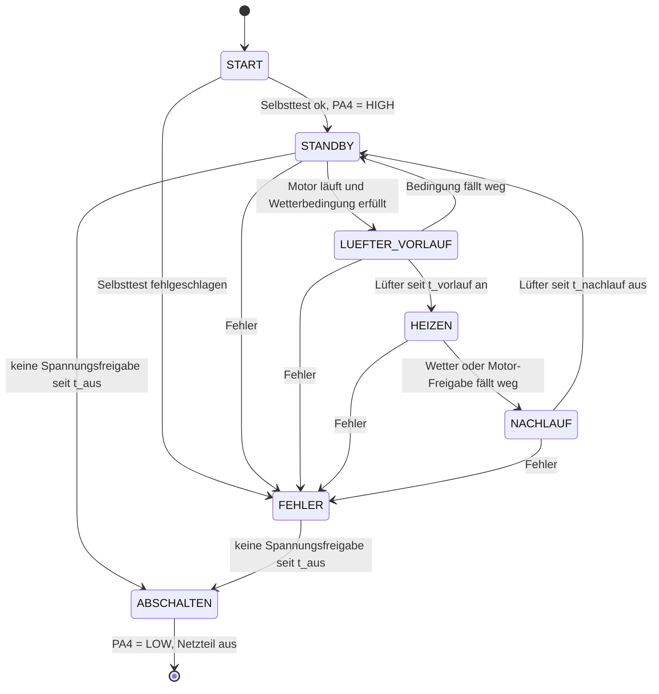

# Verhaltensspezifikation (Entwurf)

Dieses Dokument beschreibt, **wie sich das Gerät verhalten soll**. Die Firmware
wird danach umgebaut. Werte mit Status **Ist** stammen aus dem bisherigen Code,
**Log** aus den Messreihen, **Vorschlag** und **offen** sind noch zu bestätigen.
Umgesetzt (gebaut, nicht am Fahrzeug erprobt), siehe
[`../DISCLAIMER.md`](../DISCLAIMER.md).

## 1. Grundsätze

1. **Heizung aus ist der sichere Zustand.** Jede Unsicherheit (Sensorfehler,
   Spannung außerhalb des Fensters, Reset, Fehler) führt zu Heizung aus.
2. **Heizen nur, wenn alle Bedingungen gleichzeitig erfüllt sind:** Motor läuft
   (Spannungsfreigabe), Wetterbedingung erfüllt, alle Sensoren gültig, kein
   Fehler, Lüfter läuft.
3. **Das Gerät greift nicht ins Fahrzeug ein.** Es braucht nur die
   Spannungsversorgung (kein CAN-Bus).
4. **Eine Schutzebene reicht nicht:** Firmware, Watchdog und unabhängige
   Hardware-Absicherung (Abschnitt 7) arbeiten nebeneinander.

## 2. Ein- und Ausgänge

| Größe | Quelle/Ziel | Hinweis |
|---|---|---|
| Bordspannung | Teiler an PA5 | Freigabe mit Hysterese (Abschnitt 4) |
| Außenluft: Temperatur, Feuchte | DHT11 (V3.2), später besserer Sensor (V4) | Sensor-Schicht austauschbar |
| Temperatur Logo-Platte | NTC an PB4 | Regelgröße |
| Temperatur Heizelement | NTC an PA7 | Überwachung |
| Heizelement | PC2 → Treiber → MOSFET `M2` | nur ein/aus |
| Lüfter | PC3 → Treiber → MOSFET `M1` | nur ein/aus |
| Netzteil halten | PA4 (HIGH = halten) | siehe `docs/hardware-analyse-v3.2.md` |
| Fehlercode | LED an PA6, zusätzlich Debug-Ausgang (Abschnitt 7) | |

## 3. Zustände

| Zustand | Heizung | Lüfter | Beschreibung |
|---|---|---|---|
| START | aus | aus | PA4 sofort HIGH, Sensoren einlesen, Selbsttest (Sensoren im gültigen Bereich) |
| STANDBY | aus | aus | wartet auf Bedingungen |
| LUEFTER_VORLAUF | aus | an | Lüfter läuft `t_vorlauf`, bevor geheizt wird |
| HEIZEN | geregelt | an | Regelung der Plattentemperatur (Abschnitt 5) |
| NACHLAUF | aus | an für `t_nachlauf` | Heizelement kühlt ab; danach STANDBY |
| FEHLER | **aus** | Nachlauf, dann aus | Fehlercode wird angezeigt und gespeichert; nur Neustart löscht |
| ABSCHALTEN | aus | aus | PA4 = LOW; nur bei Motor aus (sonst Neustart-Schleife) |

Jeder Übergang in FEHLER schaltet die Heizung im selben Schleifendurchlauf am Pin
ab. Der Watchdog (ca. 2 s) startet den Controller bei einem Hänger neu;
Heizung und Lüfter sind im Reset über die Pulldowns `RN2` aus.

## 4. Freigaben und Wetterbedingung

**Spannungsfreigabe (Ist-Stand der Umsetzung, Werte aus den Logs):** ein ab
13,5 V nach 5 s, aus unter 13,0 V nach 3 s, sofort aus über 15,5 V
(Wiederfreigabe unter 15,0 V). Status: Log, noch am Fahrzeug zu bestätigen.

**Wetterbedingung, zwei Varianten, per Konfiguration wählbar:**

- **Variante A (Standard bis V4): kalt und feucht.** Ein, wenn
  `T_luft ≤ T_ein` und `rF ≥ rF_ein`; aus, wenn `T_luft ≥ T_ein + 1 K` oder
  `rF ≤ rF_ein − 5 %`. Start: `T_ein` = 8 °C (Ist), `rF_ein` = 80 % (laut Kommentar im
  Code, Ist-Wert 30 % ist ein Testwert), Hysterese neu.
- **Variante B (Experiment, ab besserem Sensor): Taupunkt.** Taupunkt `Td` aus
  `T_luft` und `rF` (Magnus-Formel, über Wasser `a = 17,62`, `b = 243,12`;
  für Temperaturen unter 0 °C über Eis `a = 22,46`, `b = 272,62`). Ein, wenn
  `T_platte − Td ≤ Δ_ein` und `T_luft ≤ T_max_luft`; aus bei `T_platte − Td ≥ Δ_aus`.
  Start: `Δ_ein` = 4 K, `Δ_aus` = 6 K, `T_max_luft` = 8 °C (Vorschläge).

Grenzen von Variante B: Mit dem **DHT11** (±5 % rF, ±2 °C) liegt der berechnete
Taupunkt um mehrere Kelvin daneben; deshalb ist A der Standard, bis der bessere
Sensor in V4 vorliegt und die Variante mit Messdaten geprüft ist. Der
Taupunkt erkennt außerdem Schneefall nicht, sondern nur eine Oberfläche nahe
der Kondensations-/Frostgrenze.

Fehlt ein gültiger Sensorwert, gilt die Wetterbedingung als **nicht erfüllt**.

## 5. Regelung der Plattentemperatur

Zweipunktregelung mit Hysterese um die Solltemperatur: Heizung ein bei
`T_platte ≤ T_soll − 0,5 K`, aus bei `T_platte ≥ T_soll + 0,5 K`.

**Solltemperatur als Kennlinie über der Außentemperatur** (Stützpunkte,
linear dazwischen, außerhalb konstant):

| Außentemperatur | Solltemperatur | Status |
|---|---|---|
| −20 °C | 19,5 °C | Vorschlag (entspricht dem Ist-Wert 19 bis 20 °C) |
| −5 °C | 19,5 °C | Vorschlag |
| +8 °C | 19,5 °C | Vorschlag |

Alle drei Punkte sind zunächst gleich (Verhalten wie bisher). Die Werte werden
im Fahrzeugtest ermittelt (benötigte Mindesttemperatur, Leistungsaufnahme,
Auskühlung) und danach angepasst. Untergrenze der Solltemperatur: +2 °C
(oberhalb des Gefrierpunkts, Vorschlag). Obergrenze: 25 °C.

## 6. Zeiten (Vorschläge, aus dem Ist-Code übernommen)

| Größe | Wert | Status |
|---|---|---|
| `t_vorlauf` (Lüfter vor Heizung) | 5 s | Ist |
| `t_nachlauf` (Lüfter nach Heizung/Fehler) | 30 s | Vorschlag |
| `t_aus` (Selbstabschaltung bei Motor aus, gezählt nach Ende des Nachlaufs) | 20 s | Vorschlag |
| Wetter-Wegfall bis Standby | 10 s (zeitgenau, nicht freilaufend) | Ist, korrigiert |
| NTC-/Spannungsmessung | alle 200 ms | Ist |
| Sensor (DHT11) | alle 2,1 s | Ist |

## 7. Sicherheit

**Fehler (Heizung sofort aus, Code per LED und Debug-Ausgang, Eintrag im
Fehlerspeicher):**

| Code | Ursache | Status |
|---|---|---|
| 1 | Luftsensor liefert keine gültigen Werte (5 Fehlversuche) | Ist |
| 2 | NTC Heizelement: Unterbrechung (≥ 4,7 V) oder Kurzschluss (≤ 0,15 V) | Ist/umgesetzt |
| 3 | NTC Logo-Platte: gleiche Grenzen | Ist/umgesetzt |
| 4 | Übertemperatur Heizelement (≥ 30 °C) | Ist, Auslegung offen |
| 5 | Übertemperatur Logo-Platte (≥ 40 °C) | Ist, Auslegung offen |
| 6 | Watchdog-Reset aufgetreten (nur Protokoll, kein Abschalten) | umgesetzt (Branch) |

**Ergänzungen (Entscheidung des Owners):**

1. **Thermosicherung/Thermostat am Heizelement:** Hardware-Schutz in Reihe zum
   Heizelement, unabhängig von der Firmware (Platine V4 oder extern).
2. **Sicherung am Eingang:** Absicherung der Zuleitung (Platine V4 oder extern
   am Kabelbaum).
3. **Fehlerspeicher im EEPROM:** die letzten Fehlercodes (Ringspeicher,
   24 Einträge), nach Neustart auslesbar. Schreibzyklen begrenzen
   (nur bei neuem Fehler schreiben). *Umgesetzt im Branch (`faultlog.ino`).*
4. **Debug-Ausgang:** Zustand, Messwerte und Fehlercode in Klartext über
   einen seriellen Ausgang am Prüfstand; im Normalbetrieb abschaltbar.
   Pin: PB2 (USART0 TX, Standard), auf V3.2 nur am Controller-Pad erreichbar,
   für V4 als Pad vorsehen. *Umgesetzt im Branch (`debug.ino`).*

## 8. Offene Entscheidungen

- Werte der Kennlinie und der Zeiten nach Fahrzeugtest.
- Variante B (Taupunkt) erst mit besserem Sensor und Messdaten.
- Sensorwechsel (I2C) mit V4, siehe Hinweis zu PA5/PA6 in `hardware/README.md`.
- Auslegung der Übertemperaturgrenzen (4, 5) gegen die Hardware.

## 9. Bezug

Audit: [`sicherheits-audit-firmware.md`](sicherheits-audit-firmware.md),
Hardware: [`hardware-analyse-v3.2.md`](hardware-analyse-v3.2.md),
Issues: siehe GitHub (Label `sicherheit`, `firmware`).
